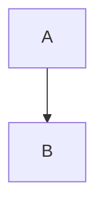
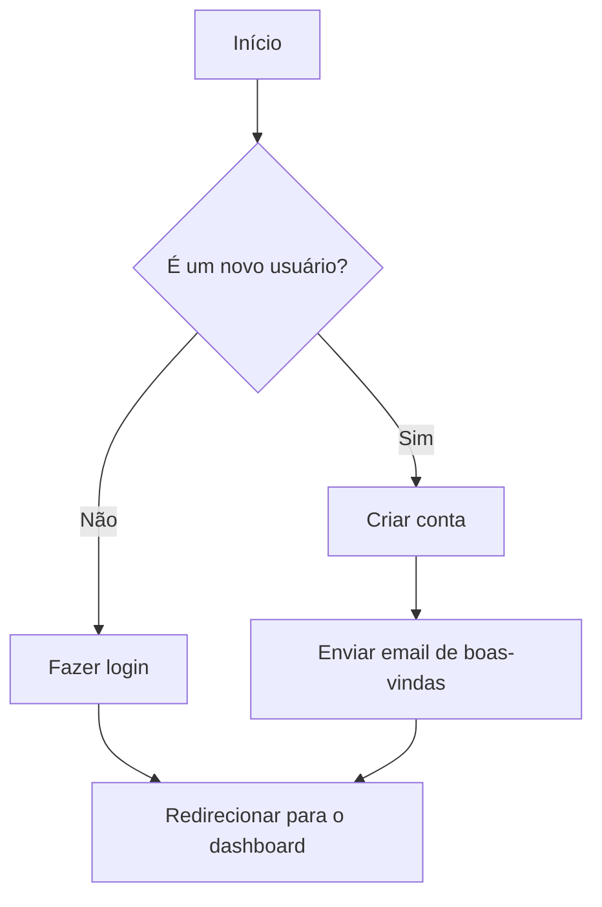
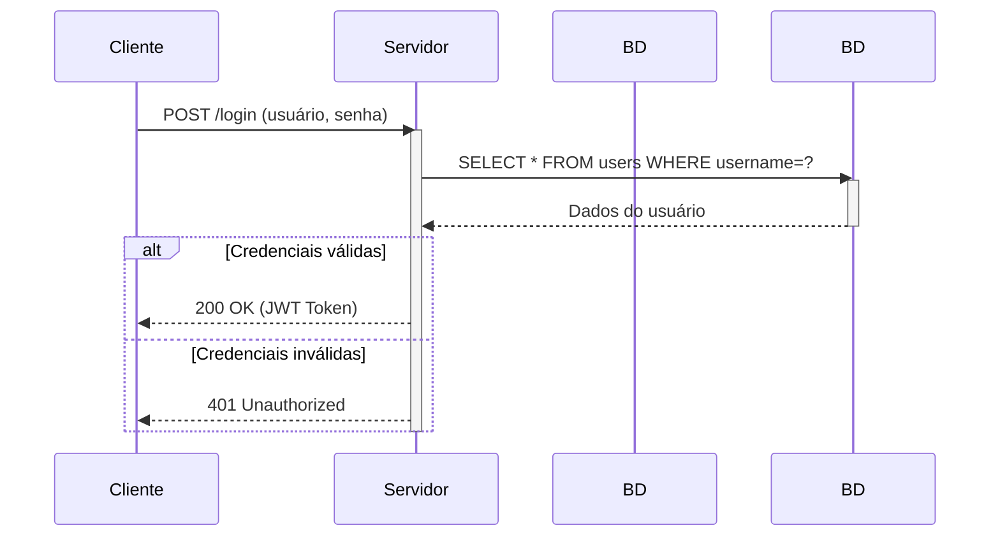
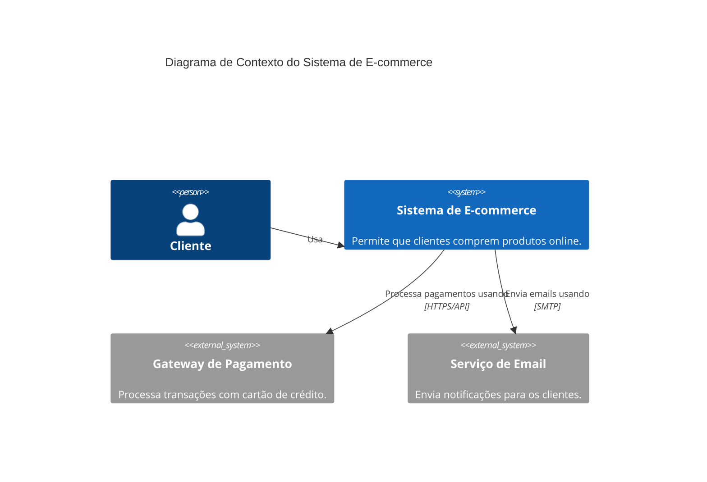

# Guia de Referência: Geração de Diagramas com Mermaid.js

Mermaid.js é uma ferramenta baseada em JavaScript que utiliza uma sintaxe inspirada em Markdown para renderizar diagramas e fluxogramas. Por ser puramente textual, é a ferramenta ideal para um agente de IA gerar documentação visual.

Este guia cobre os diagramas mais úteis para engenharia de software. Para gerar um diagrama, encapsule o código Mermaid em um bloco de código com a linguagem `mermaid`.

## 1. Fluxogramas (Flowcharts)

Usados para representar fluxos de trabalho ou processos.

### Sintaxe Básica
*   **Direção do Gráfico:**
    *   `graph TD` ou `graph TB` - Top to Bottom (de cima para baixo)
    *   `graph LR` - Left to Right (da esquerda para a direita)
*   **Nós:**
    *   `id[Texto]` - Nó retangular (padrão)
    *   `id(Texto)` - Nó com bordas arredondadas
    *   `id((Texto))` - Nó circular
    *   `id>Texto]` - Nó assimétrico
    *   `id{Texto}` - Nó em forma de losango (decisão)
*   **Links (Setas):**
    *   `A --> B` - Seta com ponta
    *   `A --- B` - Linha sem ponta
    *   `A -- Texto --> B` - Seta com texto

### Exemplo de Fluxograma

## 2. Diagramas de Sequência (Sequence Diagrams)

Mostram como objetos ou atores interagem ao longo do tempo.

### Sintaxe Básica
*   **Participantes:** Declare os atores no topo. `participant Nome`.
*   **Mensagens:**
    *   `AtorA ->> AtorB: Mensagem` - Mensagem sólida com ponta de seta (assíncrona).
    *   `AtorA -->> AtorB: Mensagem` - Linha tracejada (resposta).
*   **Ativação:** Use `activate` e `deactivate` para mostrar quando um participante está ativo (processando).
*   **Notas:** `Note right of AtorA: Texto da nota`.
*   **Loops e Condicionais:** `loop`, `alt`, `opt`.

### Exemplo de Diagrama de Sequência

## 3. Diagramas de Contexto C4 (C4 Context Diagrams)

O modelo C4 é usado para descrever a arquitetura de software em diferentes níveis de zoom. O Nível 1, Contexto, é o mais alto e mostra o sistema em seu ambiente.

### Sintaxe Básica
*   Declare o título e use `C4Context`.
*   **`Person(alias, "Nome")`**: Um usuário humano.
*   **`System(alias, "Nome", "Descrição")`**: O sistema de software que você está descrevendo.
*   **`System_Ext(alias, "Nome", "Descrição")`**: Um sistema de software externo com o qual seu sistema interage.
*   **Relações:** `Rel(alias_a, alias_b, "Descrição da Relação", "Tecnologia (opcional)")`.

### Exemplo de Diagrama de Contexto C4

## Dicas de Uso

*   **Clareza > Complexidade:** Prefira diagramas simples e focados. É melhor ter vários diagramas pequenos do que um único diagrama massivo e ilegível.
*   **Use Títulos:** Sempre inclua um `title` no seu diagrama para dar contexto.
*   **Combine com Texto:** Use o diagrama como uma ilustração visual dentro de uma explicação textual mais detalhada. Não assuma que o diagrama é autoexplicativo.
